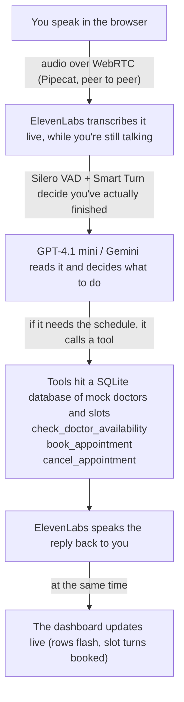

# Linden: how the voice pipeline works

## The flow (Its one call)

## The bits I'm proud of

- **Your phone number is your ID.** No login. Asha reads it back digit by digit and only books after you say yes. The code enforces this too, not just the prompt.
- **The model never counts digits.** It got a 10 digit number wrong once, so now the code extracts the digits and hands back the exact read-back.
- **No double bookings.** A database rule allows only one active booking per slot.
- **No awkward silence.** While it looks something up, it says "One moment."

## What I'd do next

Real phone calls (Twilio), Multilingual support, SMS reminders, and Postgres instead of SQLite.
