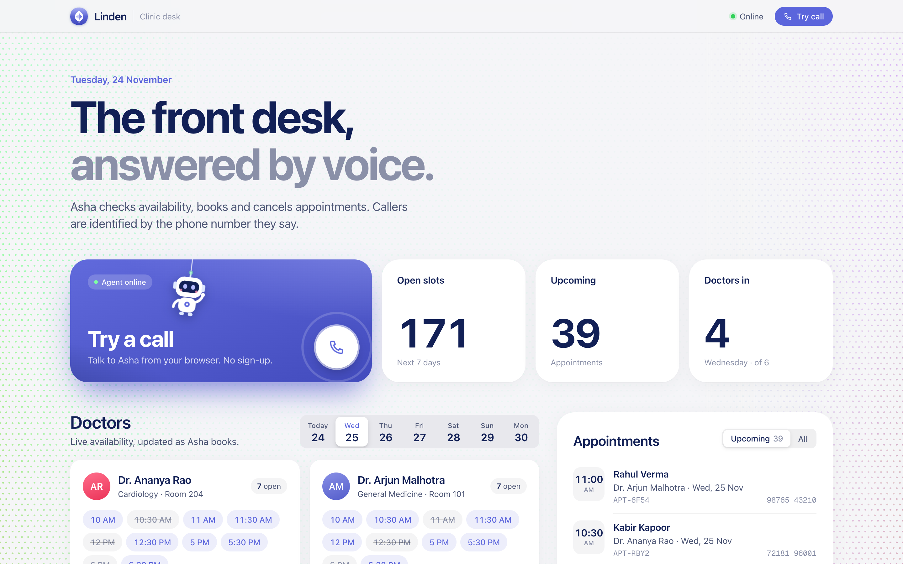
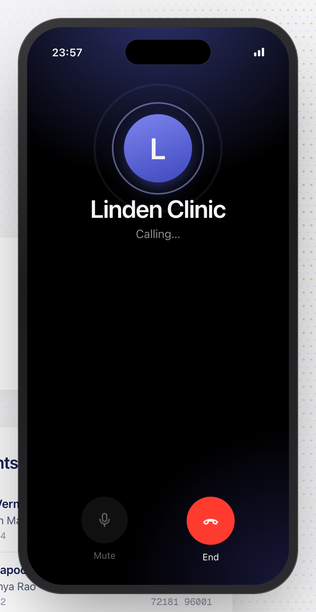
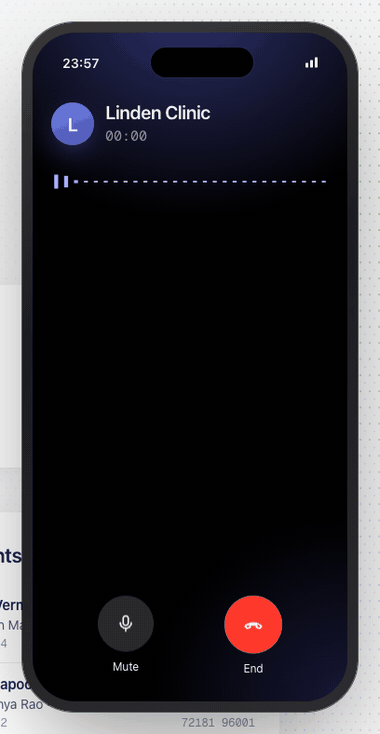
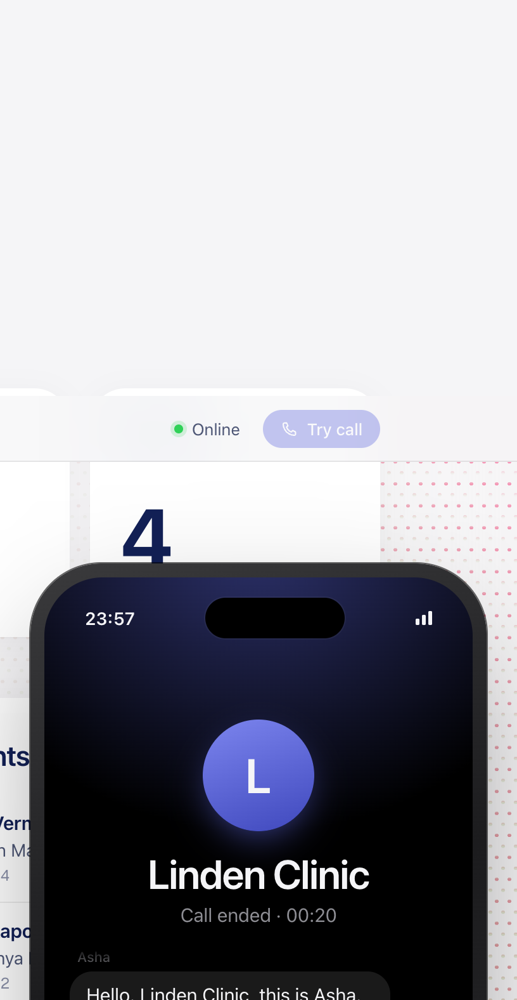
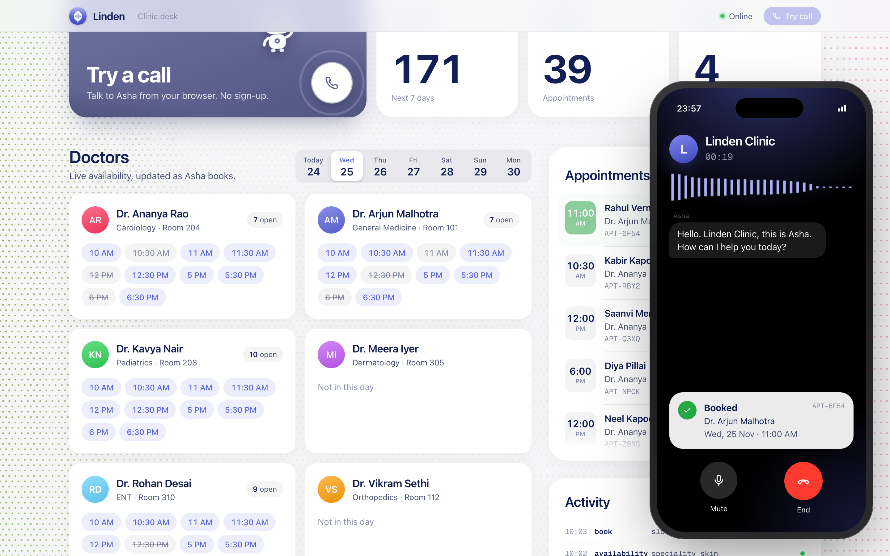
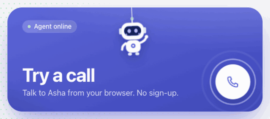
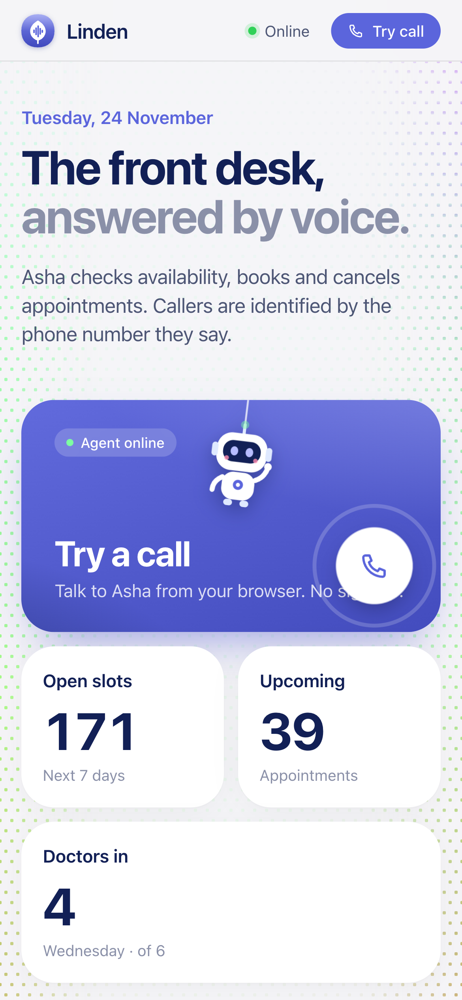
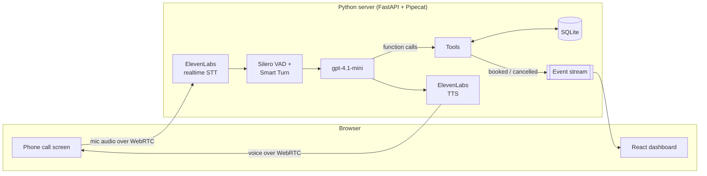

<div align="center">


# Linden

**A voice receptionist for a doctor's clinic.**
Call from the browser, ask for a doctor, book or cancel. Asha listens, checks the schedule and confirms your number before touching anything.

<p>
  
  
  
  
  
  
  
  
</p>

<a href="#quick-start">Quick start</a> ·
<a href="#how-it-works">How it works</a> ·
<a href="#features">Features</a> ·
<a href="#project-structure">Structure</a> ·
<a href="#design-decisions">Design decisions</a>

<br /><br />



</div>

---

## A call, start to finish

<table>
  <tr>
    <td width="33%" align="center"><br /><sub><b>Ringing</b><br />pulse rings and a ring tone</sub></td>
    <td width="33%" align="center"><br /><sub><b>Connected</b><br />live waveform, timer, transcript</sub></td>
    <td width="33%" align="center"><br /><sub><b>Ended</b><br />duration, end tone, then it tucks away</sub></td>
  </tr>
</table>

When Asha books, the whole desk reacts at once: a confirmation card slides up inside the phone, the new appointment flashes in the list, the slot turns booked, and the activity log records each tool call.



<table>
  <tr>
    <td width="62%" valign="top">
      <h3>The call button has a tenant</h3>
      <p>A small robot hangs from the top of the <b>Try a call</b> card. It swings on its string, blinks, waves every few seconds, strolls from side to side and waves faster when you hover. The moment a call starts it freezes mid-step, so your attention goes to the phone.</p>
      
    </td>
    <td width="38%" align="center" valign="top">
      <h3>Mobile</h3>
      
      <br /><sub>Single column; the phone goes full screen during a call.</sub>
    </td>
  </tr>
</table>

---

## Features

**Voice agent**
- Three tools wired into Pipecat function calling: `check_doctor_availability`, `book_appointment`, `cancel_appointment`
- The caller is identified **only** by the phone number they say. No login, no OTP, no caller ID
- The number is read back digit by digit and confirmed before booking or cancelling, enforced in code as well as in the prompt
- Spoken numbers in any shape: "nine eight seven", "double nine", "+91 ...", or split across two sentences
- Check, book and cancel in one natural conversation; cancelling confirms *which* appointment first
- Streaming speech-to-text, Silero VAD and Smart Turn for quick, polite turn-taking with barge-in
- A short "One moment." while it looks things up, so there's no dead air

**Dashboard**
- Doctors with live slots per day, an appointments list and an agent activity log, all updated in real time over Server-Sent Events
- Phone-style call screen: ringing, connected and ended states, caller name, timer, mute, end call, live transcript, voice waveform, booking card, ring and end-call tones
- Rows and slots highlight when the agent books or cancels
- Mobile layout, reduced-motion and reduced-transparency support
- Clear errors: if a key is missing, the phone tells you which one instead of ringing forever

---

## Quick start

**You need:** Python 3.12, Node 20+, an OpenAI API key (or a free Gemini key), and an ElevenLabs API key with *Speech to Text* and *Text to Speech* permissions.

```bash
# 1. Server
cd server
python3.12 -m venv .venv && source .venv/bin/activate
pip install -r requirements.txt
cp .env.example .env          # add OPENAI_API_KEY and ELEVENLABS_API_KEY
uvicorn app.main:app --port 7860
```

```bash
# 2. Dashboard (new terminal)
cd web
npm install
npm run dev                    # http://localhost:5173
```

Open **http://localhost:5173 in Chrome**, click **Try a call** and allow the microphone.

> [!TIP]
> Want to try cancelling? Number **98765 43210** already has a booking with Dr. Malhotra.
> Reset the demo data any time with **Reset data** in the footer or `python -m app.seed --reset`.

> [!NOTE]
> On the ElevenLabs free plan the voice must be one of the **default** voices; Voice Library voices are refused over the API. `.env.example` ships with one that works.

<details>
<summary><b>Configuration</b></summary>

| Variable | Default | What it does |
|---|---|---|
| `LLM_PROVIDER` | `gemini` | `openai` or `gemini` |
| `OPENAI_API_KEY` / `OPENAI_MODEL` | `gpt-4.1-mini` | Used when the provider is OpenAI |
| `GOOGLE_API_KEY` / `GEMINI_MODEL` | `gemini-2.5-flash` | Used when the provider is Gemini (free tier) |
| `ELEVENLABS_API_KEY` | | Speech-to-text and text-to-speech |
| `ELEVENLABS_VOICE_ID` | Sarah (default voice) | Must be a default voice on the free plan |
| `ELEVENLABS_TTS_MODEL` | `eleven_flash_v2_5` | Lowest-latency ElevenLabs model |
| `STT_MODE` | `realtime` | `segmented` uploads each finished sentence instead of streaming |
| `CLINIC_TZ` | `Asia/Kolkata` | Clinic timezone for dates and slots |

</details>

---

## How it works



1. The browser connects to the server over **WebRTC** using Pipecat's peer-to-peer transport, so there is no third-party room service.
2. Caller audio streams to **ElevenLabs realtime speech-to-text**. **Silero VAD** spots speech and Pipecat's **Smart Turn** model decides when the caller has really finished.
3. **gpt-4.1-mini** answers, calling the three tools when it needs the schedule. Tools read and write a **SQLite** database of mock doctors and 30-minute slots.
4. The reply is spoken by **ElevenLabs Flash v2.5** and streamed back to the browser.
5. Every tool call also goes out on a **Server-Sent Events** stream, which is how the dashboard updates and highlights rows live.

More detail in [PIPELINE.md](PIPELINE.md); the reasoning behind each choice is in [NOTES.md](NOTES.md).

---

## Project structure

```
server/app/
  bot.py          Pipecat pipeline: STT, turn-taking, LLM, TTS, filler speech
  tools.py        the three tools + Pipecat registration
  prompts.py      system prompt, rebuilt per call with today's dates
  phone.py        turns spoken numbers into digits and read-backs
  repository.py   every SQL query
  db.py, seed.py  schema, transactions and mock data
  events.py       in-process pub/sub behind the event stream
  main.py         FastAPI: REST, event stream, WebRTC signalling
web/src/
  hooks/          useCall (call lifecycle, transcript), useClinicData (REST + live events)
  components/     PhoneCall, Waveform, DoctorsPanel, AppointmentsPanel, ActivityLog, Robot, ...
  styles/         design tokens and layout
```

---

## Design decisions

- **Double booking is impossible.** Writes run in a `BEGIN IMMEDIATE` transaction and a partial unique index allows one active booking per slot.
- **Digits are counted by code, not the model.** Language models miscount long numbers, so the tool extracts the digits and hands back the exact read-back sentence.
- **Two-step cancel inside one tool.** Without an `appointment_id` it lists the caller's appointments; the agent confirms which one, then calls again.
- **The phone number gate lives in code.** `book_appointment` and `cancel_appointment` refuse to act until `phone_confirmed` is true, whatever the prompt says.

## Tests

```bash
cd server && pytest      # 20 tests: phone parsing, dates, booking rules, tools, live events
```

## Credits

Walking crowd adapted from [Skiper UI](https://skiper-ui.com) with illustrations by [Open Peeps](https://www.openpeeps.com/). Dot background adapted from [Gradient Dots](https://21st.dev/@efferd/components/gradient-dots) by efferd. All doctors, patients and phone numbers are fictional.
